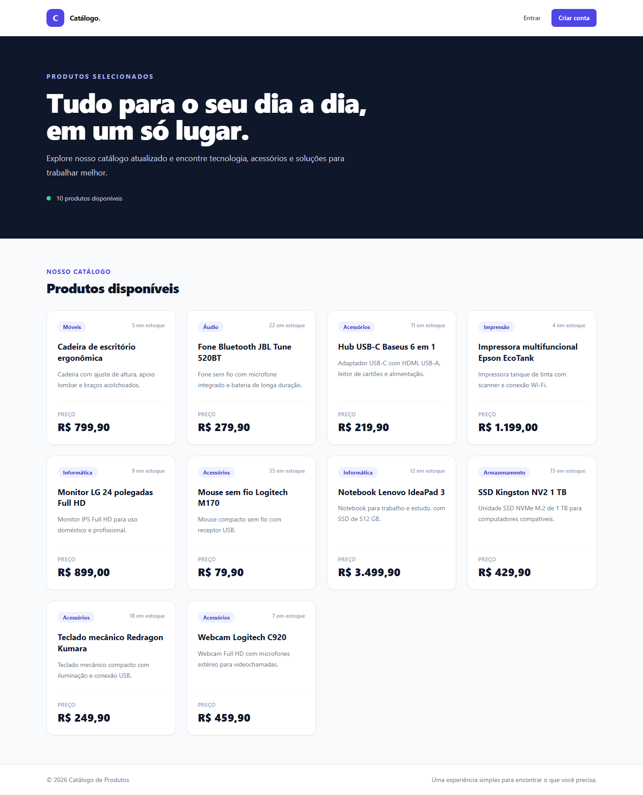
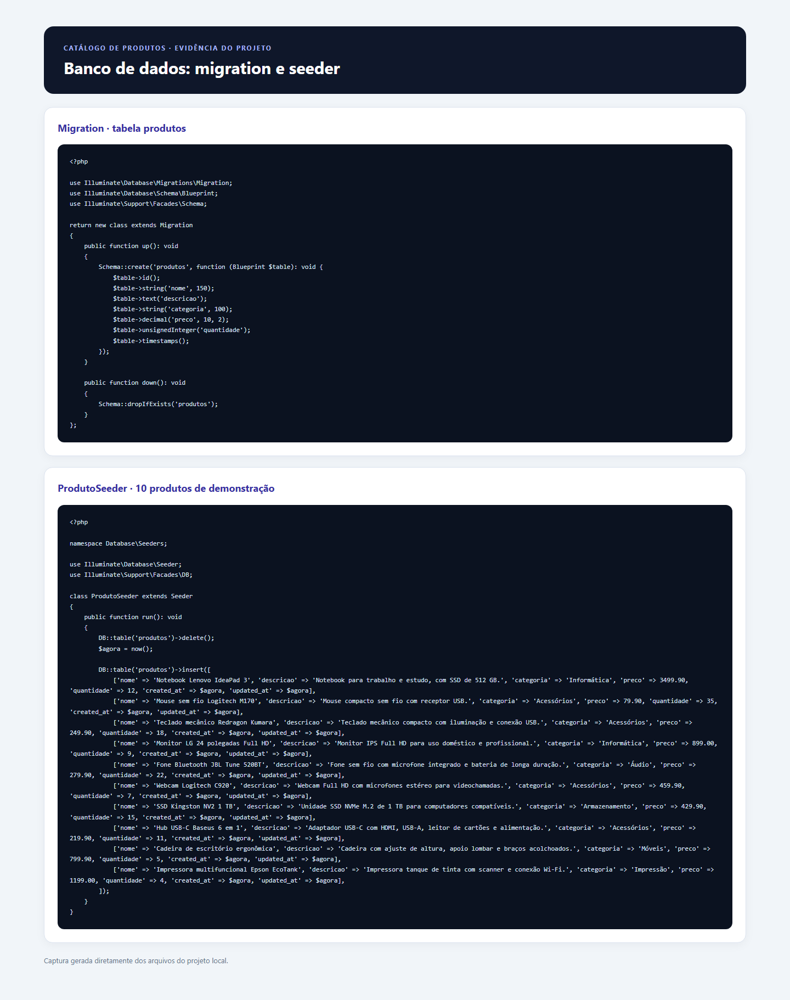
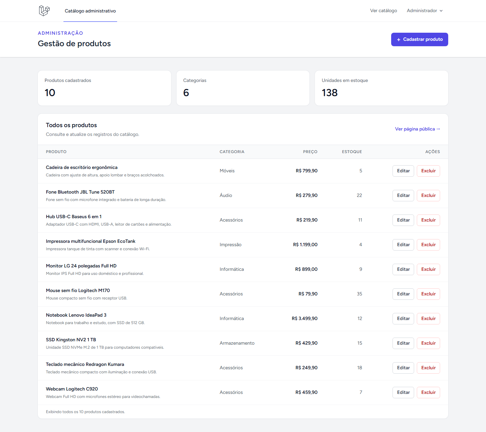
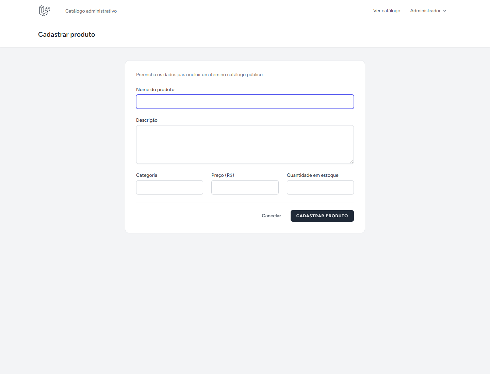
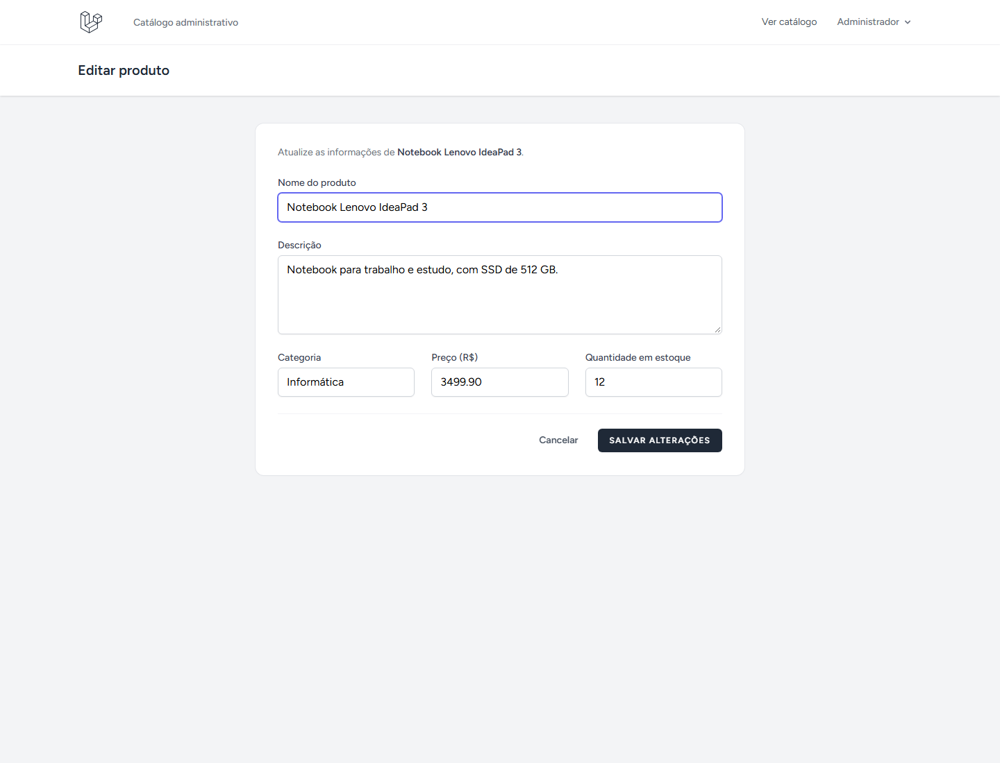
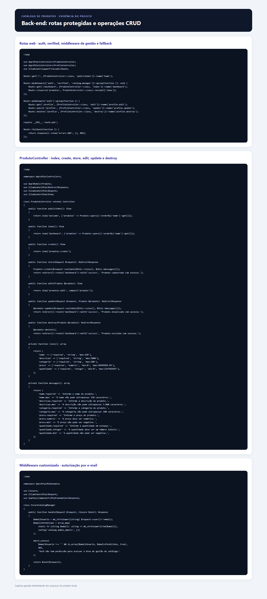

# Sistema de Catálogo e Gestão de Produtos

Aplicação web em Laravel para consulta pública e administração de um catálogo de produtos. Visitantes podem ver todos os produtos disponíveis; administradores autenticados e com e-mail verificado podem cadastrar, editar e excluir itens.

## Tecnologias

- PHP 8.2+
- Laravel 12
- Laravel Breeze com Blade
- Tailwind CSS e Vite
- Node.js e npm
- SQLite

## Funcionalidades

- Cadastro, login, logout, recuperação e redefinição de senha pelo Breeze.
- Verificação de endereço de e-mail para proteger as rotas administrativas.
- Catálogo público com nome, descrição, categoria, preço e estoque.
- Dashboard administrativo com todos os produtos e ações de CRUD.
- Validação no servidor dos campos de produto.
- Middleware `catalog.manager` com lista de e-mails administradores configurável.
- Rota fallback com página 404 personalizada.
- Dez produtos de demonstração incluídos no seeder.

## Requisitos locais

Instale PHP 8.2 ou superior com as extensões PDO SQLite, OpenSSL, Mbstring, Tokenizer, XML, Ctype, cURL, DOM e Fileinfo; Composer; Node.js e npm.

No Windows, confirme se `pdo_sqlite` e `sqlite3` aparecem neste comando:

```powershell
php -m | Select-String -Pattern 'pdo_sqlite|sqlite3'
```

## Instalação

Clone o repositório e entre na pasta do projeto:

```powershell
git clone <URL_DO_SEU_REPOSITORIO>
cd catalogo-produtos
```

Instale as dependências PHP e JavaScript:

```powershell
composer install
npm install
```

Configure o arquivo de ambiente e a base SQLite:

```powershell
Copy-Item .env.example .env
New-Item -ItemType File -Path database/database.sqlite -Force
php artisan key:generate
```

No `.env`, configure:

```dotenv
APP_NAME="Catálogo de Produtos"
APP_URL=http://127.0.0.1:8000
DB_CONNECTION=sqlite
DB_DATABASE=database/database.sqlite
MAIL_MAILER=log
CATALOG_ADMIN_EMAILS=admin@example.com
```

O usuário administrador precisa se registrar com um e-mail listado em `CATALOG_ADMIN_EMAILS`. Para cadastrar outros administradores, separe os e-mails por vírgulas. Em desenvolvimento, os links de verificação e recuperação de senha são gravados em `storage/logs/laravel.log` pelo mailer `log`.

Execute as migrations e carregue os dados de demonstração:

```powershell
php artisan config:clear
php artisan migrate --seed
```

Compile os arquivos do frontend e inicie o servidor:

```powershell
npm run build
php artisan serve
```

Abra [http://127.0.0.1:8000](http://127.0.0.1:8000). Para desenvolvimento com atualização automática dos assets, use `npm run dev` em outro terminal.

## Operações CRUD

| Operação | Método e rota | Resultado |
| --- | --- | --- |
| Listar | `GET /dashboard` ou `GET /produtos` | Exibe todos os produtos no painel |
| Criar formulário | `GET /produtos/create` | Abre o formulário de cadastro |
| Salvar | `POST /produtos` | Valida e cadastra um produto |
| Editar formulário | `GET /produtos/{produto}/edit` | Abre o formulário preenchido |
| Atualizar | `PUT /produtos/{produto}` | Valida e salva as alterações |
| Excluir | `DELETE /produtos/{produto}` | Remove o produto |

As rotas de gestão requerem sessão autenticada (`auth`), e-mail verificado (`verified`) e autorização pelo middleware `catalog.manager`. A página inicial `/` permanece pública.

## Banco de dados

A migration `database/migrations/2026_11_18_010509_create_produtos_table.php` cria a tabela `produtos` com `id`, `nome`, `descricao`, `categoria`, `preco`, `quantidade`, `created_at` e `updated_at`. O `DatabaseSeeder` chama `ProdutoSeeder`, que insere dez produtos de exemplo.

Para recriar o banco local com os dados de exemplo:

```powershell
php artisan migrate:fresh --seed
```

## Capturas de tela para a entrega

As capturas abaixo foram geradas a partir da aplicação local e dos arquivos atuais do projeto.

### Site funcionando em localhost



### Migrations e seeders



### Front-end: operações CRUD







### Back-end: operações CRUD



## Publicação no GitHub

Crie um repositório no GitHub e envie o código:

```powershell
git add .
git commit -m "feat: cria catálogo e gestão de produtos"
git branch -M main
git remote add origin <URL_DO_SEU_REPOSITORIO>
git push -u origin main
```

Não versione `.env`, `vendor/` nem `node_modules/`. O `.gitignore` padrão do Laravel já exclui esses arquivos.
